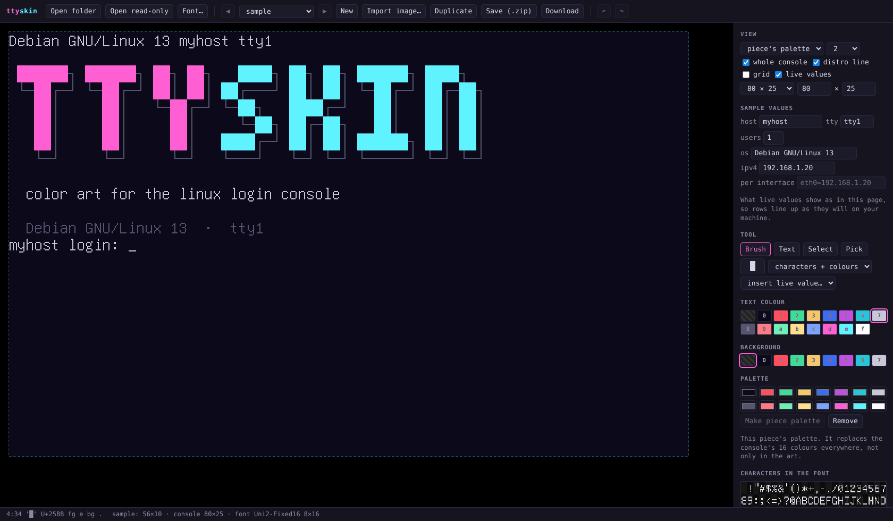

```text
██████┐ ██████┐ ██┐ ██┐   ████┐ ██┐ ██┐ ██████┐ ████┐
└─██┌─┘ └─██┌─┘ ██│ ██│ ██┌───┘ ██│ ██│ └─██┌─┘ ██┌─██┐
  ██│     ██│   └─██┌─┘ └─██┐   ████┌─┘   ██│   ██│ ██│
  ██│     ██│     ██│     └─██┐ ██┌─██┐   ██│   ██│ ██│
  ██│     ██│     ██│   ████┌─┘ ██│ ██│ ██████┐ ██│ ██│
  └─┘     └─┘     └─┘   └───┘   └─┘ └─┘ └─────┘ └─┘ └─┘

  color art for the linux login console
```

ttyskin puts color text art on the Linux login console: the text screen a machine shows after it boots, above the `login:` prompt. You keep as many pieces of art as you like and switch between them with one command.

- **`ttyskin`** installs a piece, removes it, and checks pieces against the console's font and size.
- **`ttyskin.html`** shows pieces exactly as the console draws them, in the console's own bitmap font, and lets you edit them.

**Try the page in your browser:** [ttyskin.donliggett.com](https://ttyskin.donliggett.com). It runs entirely in the browser; nothing is uploaded.



## How it works

- The login prompt (`agetty`) prints `/etc/issue` and then every file in `/etc/issue.d/`. ttyskin writes one file there, `/etc/issue.d/ttyskin.issue`. It never edits `/etc/issue`.
- Color comes from standard escape sequences in that file: 16 colors for text, 8 for backgrounds.
- A piece can also bring its own palette: the 16 colors themselves. ttyskin sets them with `setvtrgb`, and a small boot unit keeps them across reboots. A palette applies to the whole console, not only to the art.
- Art can include live values that the login prompt fills in each time it draws: host name, IP address, date, time, logged-in users, terminal name, OS name.
- After a change, ttyskin clears the consoles waiting at a login prompt and asks the prompts to redraw, so the art appears at the top straight away, with no reboot. A console where someone is logged in is never cleared.

## Requirements

- Linux with a text console and `agetty` from util-linux 2.36 or newer
- Python 3.8 or newer (standard library only)
- `setvtrgb` (from the `kbd` package), for pieces with a palette
- For the page: any current browser; Chrome or Edge to save into folders

## Install

### Debian and Ubuntu

```sh
sudo apt install git kbd
sudo git clone https://github.com/donliggett/ttyskin.git /opt/ttyskin
sudo ln -s /opt/ttyskin/ttyskin /usr/local/bin/ttyskin
sudo cp /opt/ttyskin/systemd/ttyskin-palette.service /etc/systemd/system/
sudo systemctl daemon-reload
sudo systemctl enable ttyskin-palette.service
```

### Other distributions

Install `git`, Python 3 and the package that provides `setvtrgb` (usually `kbd`), and check that `agetty --version` reports 2.36 or newer. Then run the same commands from `sudo git clone` on.

### After installing

- **Update:** `sudo git -C /opt/ttyskin pull`.
- **Your own pieces:** keep them in any folder and point ttyskin at it, either with `--dir` or once for all commands:

  ```sh
  sudo mkdir -p /etc/ttyskin
  echo "pieces_dir=/path/to/your/pieces" | sudo tee /etc/ttyskin/config
  ```

  Without that, ttyskin uses `/opt/ttyskin/pieces`, which holds the sample.

## Use

```sh
ttyskin list                    # the pieces; * marks the one in use
ttyskin show sample             # print a piece in this terminal
ttyskin check sample            # check it against the console's font and size
sudo ttyskin use sample --dry-run
sudo ttyskin use sample         # install it
sudo ttyskin off                # remove it and restore the console's palette
ttyskin status
```

| command | what it does |
| --- | --- |
| `list` | lists the pieces, marking the one in use |
| `show <name>` | prints the piece in this terminal; `--issue` prints the file it would install |
| `check <name>` | checks color codes, characters against the console font, and width against the console |
| `use <name>` | installs the piece and its palette, then redraws the login prompt (root) |
| `off` | removes the art, restores the palette saved before the first `use`, and redraws (root) |
| `status` | the piece in use, the palette, the font, the console's size |
| `font export` | writes the console font as JSON, for loading into the page |

Options for every command: `--dir <folder>` (where the pieces are), `--font <file>` (a `.psf`, `.psf.gz` or exported `.json`), `--size <columns>x<rows>`. `use` and `off` also take `--dry-run` and `--force`.

The pieces folder is, in order: `--dir`, the `TTYSKIN_PIECES` environment variable, `pieces_dir=` in `/etc/ttyskin/config`, or the `pieces` folder next to the command.

Exit codes: `0` done, `1` the piece failed its check, `2` usage, `3` needs root, `4` something the machine lacks, `5` a file ttyskin didn't write is in the way.

## A piece

A piece is a folder, named in lowercase letters, digits and dashes:

```text
pieces/<name>/
  art.txt       the characters, one line per row
  fg.txt        text color per cell: 0-f a palette slot, . the default   (optional)
  bg.txt        background color per cell: 0-7, or .                   (optional)
  palette.txt   16 lines of #rrggbb, in console order                   (optional)
  piece.json    {"title", "author", "license", "notes"}                  (optional)
```

`fg.txt` and `bg.txt` have the same shape as `art.txt`. Live values are written in `art.txt` as `{host}`, `{ipv4}`, `{ipv4:eth0}`, `{date}`, `{time}`, `{users}`, `{tty}` and `{os}`; each takes the color of its first cell. Other text in braces is drawn as written.

Only the sample piece is tracked by git; other folders in `pieces/` are ignored, so your own art stays yours. `pieces/sample` is the wordmark above, with a palette and two live values.

The full format is in [docs/SPEC.md](docs/SPEC.md).

## The page

Open `ttyskin.html` in a browser. It works from disk with no server and no network. The [guide](docs/GUIDE.md) walks through making a piece, live values, importing an image and putting the result on a machine.

- **Open folder** (Chrome, Edge): pick a pieces folder, or one piece's folder. **Save** writes back into the piece's files.
- **Open read-only** (any browser): view and edit; **Download** saves the piece as a `.zip`.
- **View:** the piece's palette or a default one, the whole console with its login prompt or the art alone, a grid, and live values filled in with samples. `←` and `→` flip between pieces.
- **Edit:** a brush (right-click erases, Alt+click picks), text, selections you can move, copy and paste, undo, a palette editor, and every character the font has. Characters the font lacks are outlined in red.
- **Sample values:** what live values show as in the page (host name, addresses, OS, terminal, users), so rows with live values line up as they will on your machine.
- **Font:** the page includes the common 8×16 console font. `ttyskin font export -o font.json` on a machine writes that machine's font for **Font…**.

### Import an image

**Import image…**, or dropping an image file on the page, turns a picture (PNG, JPEG, WebP, GIF, SVG) into a piece that the console shows exactly as previewed. Choose:

- **Width** in columns; the height follows the picture's shape.
- **Palette:** 16 colors taken from the image, the open piece's palette, or the Linux or Ubuntu default.
- **Characters:** blocks, blocks and lines (better edges), or every character in the font (slow for large widths).
- **Into:** a new piece, or replace the open piece (one undo brings it back).

Transparent parts of the picture get no background color. The result is a normal piece: finish it with the brush and text tools.

## Uninstall

```sh
sudo ttyskin off
sudo systemctl disable ttyskin-palette.service
sudo rm /etc/systemd/system/ttyskin-palette.service /usr/local/bin/ttyskin
sudo rm -r /etc/ttyskin /opt/ttyskin
```

## Tests

```sh
python3 -m unittest discover -s tests
```

The tests run against a temporary folder standing in for `/` and change nothing on the machine.

## License

MIT. The bundled console font comes from console-setup and is in the public domain; see [LICENSE](LICENSE).
